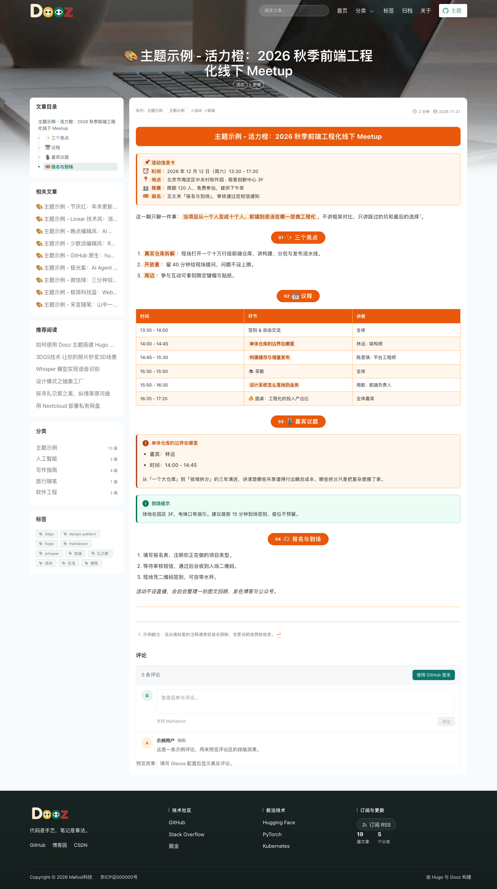

<div align="center">
<br/>


<br/>
<b>A Hugo blog theme built for reading, with typography you can pick per article</b>
<br/>
<a href="README.md">English</a> | <a href="README.zh.md">中文</a>
<br/><br/>
</div>

Dooz is a Hugo blog theme focused on reading and writing: write in Markdown, pick one of ten typography styles for each article, and get search, table of contents and comments out of the box.

<br/>

<div align="center">
<!-- Preview images live in images/ -->


<br/>
<sub>Left: home list　Right: article page (any of ten typography styles)</sub>
</div>

<br/>

## Quick start

Requires Hugo 0.158 or newer.

**1. Install Hugo**: follow the [official guide](https://gohugo.io/installation/) for your platform. Run `hugo version` afterwards; a version number means it is ready.

**2. Create a site and add the theme**

```bash
hugo new site my-blog
cd my-blog
git init

# Add the Dooz theme
git submodule add https://github.com/hollson/hugo-theme-dooz themes/hugo-theme-dooz

# Use the prepared example configuration
cp themes/hugo-theme-dooz/exampleSite/config.toml .
```

**3. Preview locally**

```bash
hugo server -D
```

Open `http://localhost:1313` and you get a complete blog with posts, categories, tags, search and a sidebar.

To explore first, run the example site instead. It contains nearly twenty posts and covers all ten typography styles:

```bash
cd themes/hugo-theme-dooz/exampleSite
hugo server --themesDir ../..
```

<br/>

## Writing and formatting

Posts live in `content/post/`. The command below creates a new post from the theme's archetype, with comments explaining each field:

```bash
hugo new post/hello.md
```

```yaml
---
title: "My first post"
date: 2026-01-01T10:00:00+08:00
description: "One sentence summarising the post, used in lists and search results."
tags: ["notes"]
cover_image: "/post/cover.jpg"   # list thumbnail, optional
mdTheme: "essay-songyan"         # typography style for this post, optional
pinned: false                    # pin to top
weight: 100                      # lower value ranks higher
---
```

What the common fields do:

| Field | Purpose |
| :--- | :--- |
| `title` / `date` | Title and publish time; lists are ordered newest first |
| `description` | Summary shown in lists and search results |
| `tags` / `categories` | Tags and categories; taxonomy pages are generated automatically |
| `cover_image` | List thumbnail; without it the card is text only |
| `mdTheme` | Typography style for this post, overriding the site default |
| `pinned` / `weight` | Pinning and ordering; `weight` defaults to 100 when omitted |

Body text uses standard Markdown: headings, lists, tables, images, blockquotes, task lists and code blocks all work directly. Code blocks detect the language, support one-click copy and collapse long code; for diagrams or formulas, add `libraries: ["mermaid"]` or `["katex"]` to load them on demand.

<br/>

## Styles and appearance

**Typography** can be set per post or as a site-wide default:

```yaml
mdTheme: "dev-linear"
```

```toml
# config.toml
[params]
  markdownTheme = "dev-linear"
```

Ten styles by use case:

- Product reviews and long-form analysis: `editorial-sspai`, `editorial-latepost`
- Essays, notes and book reviews: `essay-songyan`
- Technical docs, API references and tutorials: `dev-linear`, `dev-tech-blue`, `dev-wechat-green`
- Event notices and workshop invitations: `meetup-vibrant`, `meetup-aurora`
- Holiday announcements and year-end reviews: `daily-festive-red`
- Manuals and configuration guides: `plain-github`

**Color themes**: five presets, one parameter for the whole site:

```toml
[params]
  themeName = "navy"   # default / amber / navy / purple / terracotta
```

**Site details**: title, author, avatar, slogan, footer and social accounts are all in `config.toml`, each field annotated. Search, table of contents, comments and the remote announcement are preconfigured; comments start working once your own repository details are filled in.

<br/>

## Publishing

From writing locally to binding a domain and deploying automatically, the full steps are in this example post: [**Build and publish a Hugo blog →**](exampleSite/content/post/hugo-static-blog-guide.md)

GitHub Pages, Vercel and Netlify all work; free tiers are usually enough for a personal blog.

<br/>

## Feedback

Found a problem or have a suggestion? [Open an issue](https://github.com/hollson/hugo-theme-dooz/issues). If the theme helps you, a **Star** is appreciated.

Please remove real personal QR codes, email addresses and phone numbers from examples, screenshots and docs before submitting.

<br/>

## License

This theme is released under the [MIT](LICENSE) license.
