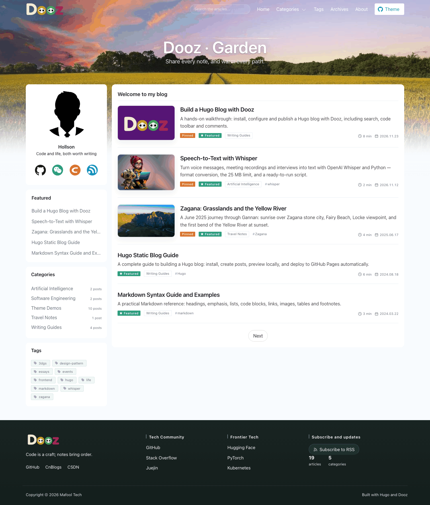

<div align="center">
<br/>
<a href="https://gohugo.io/"></a>
<a href="https://github.com/hollson/hugo-theme-dooz"></a>
<a href="https://commonmark.org/"></a>
<a href="https://github.com/hollson/hugo-theme-dooz/tree/master/exampleSite/content/post"></a>
<a href="https://github.com/hollson/hugo-theme-dooz/blob/master/LICENSE"></a>
<br/>
<b>A Hugo blog theme built for reading and free to customize</b>
<br/>
<a href="README.md">English</a> | <a href="README.zh.md">中文</a>
<br/><br/>
</div>


Dooz is a [Hugo](https://gohugo.io) blog theme built for reading and writing: posts in Markdown, typography switchable per article, and search, table of contents and comments ready out of the box.

---




<br/>

## Quick start

> Requires Hugo 0.158 or newer.

**1. Install Hugo**: follow the [official guide](https://gohugo.io/installation/) for your platform. Run `hugo version` afterwards; a version number means it is ready.

**2. Try the example site**: see the result before building your own. It contains nearly twenty posts and covers every typography style.

```bash
git clone --depth 1 https://github.com/hollson/hugo-theme-dooz.git
cd hugo-theme-dooz

# Shortcut: start the example site (port 1314)
make run
```

Without make, or to start it manually:

```bash
cd exampleSite
hugo server --themesDir ../.. -p 1314
```

Open `http://localhost:1314` to browse the home page, article page, categories, tags, search and sidebar. Delete the folder when you are done.

**3. Create your site and add the theme**

```bash
hugo new site my-blog
cd my-blog
git init

# Add the Dooz theme
git submodule add https://github.com/hollson/hugo-theme-dooz themes/hugo-theme-dooz

# Use the prepared example configuration
cp themes/hugo-theme-dooz/exampleSite/config.toml .

# Preview locally
hugo server -D
```

Open `http://localhost:1313` again: this is now your own site. Configuration, posts and styles can be replaced step by step.

<br/>

## Writing and formatting


Posts live in `content/post/`. The command below creates a post from the theme's archetype, with comments explaining each field:

```bash
hugo new post/hello.md
```

```yaml
---
title: "My first post"
date: 2026-01-01T10:00:00+08:00
description: "One sentence summarising the post, used in lists and search results."
tags: ["Notes"]
cover_image: "/post/cover.jpg"   # list thumbnail, optional
mdTheme: "essay-songyan"         # typography for this post, optional
pinned: false                    # pin to top
weight: 100                      # lower value ranks higher
---
```

What the common fields do:

| Field | Purpose |
| :--- | :--- |
| `title` / `date` | Title and publish time; lists are ordered newest first |
| `description` | Summary shown in lists and search results |
| `tags` / `categories` | Tags and categories; archive pages are generated automatically |
| `cover_image` | List thumbnail; without it the card is text only |
| `mdTheme` | Typography for this post, overriding the site default |
| `pinned` / `weight` | Pinning and ordering; `weight` defaults to 100 when omitted |

Body text uses standard Markdown: headings, lists, tables, images, blockquotes, task lists and code blocks all work directly. Code blocks detect the language and support one-click copy and long-code folding; for diagrams or formulas, add `libraries: ["mermaid"]` or `["katex"]` to load them on demand.

<br/>

## Styles

**Typography** can be set per post or as a site-wide default:

```yaml
mdTheme: "dev-linear"
```

```toml
# config.toml
[params]
  markdownTheme = "dev-linear"
```

Styles by use case:

- Product reviews and long-form analysis: `editorial-sspai`, `editorial-latepost`
- Essays, notes and book reviews: `essay-songyan`
- Technical docs, API references and tutorials: `dev-linear`, `dev-tech-blue`, `dev-wechat-green`
- Event notices and workshop invitations: `meetup-vibrant`, `meetup-aurora`
- Holiday announcements and year-end reviews: `daily-festive-red`
- Manuals and configuration guides: `plain-github`

**Color themes** are optional; one parameter changes the whole site:

```toml
[params]
  themeName = "navy"   # default / amber / navy / purple / terracotta
```

**Site details**: title, author, avatar, slogan, footer and social accounts are set in `config.toml`, each field annotated. Search, table of contents, comments and the remote announcement are preconfigured; comments start working once your own repository details are filled in.

<br/>

## Publishing

From local writing to domain binding and automated deployment, the full steps are in this example post: [**Building and publishing a Hugo blog →**](exampleSite/content/post/hugo-static-blog-guide.md)

GitHub Pages, Vercel and Netlify all work; free tiers usually cover a personal blog.

<br/>

## Feedback

Found a problem or have a suggestion? [Open an issue](https://github.com/hollson/hugo-theme-dooz/issues). If the theme helps you, a **Star** is appreciated.

<br/>

## License

Released under the [MIT](LICENSE) license.
