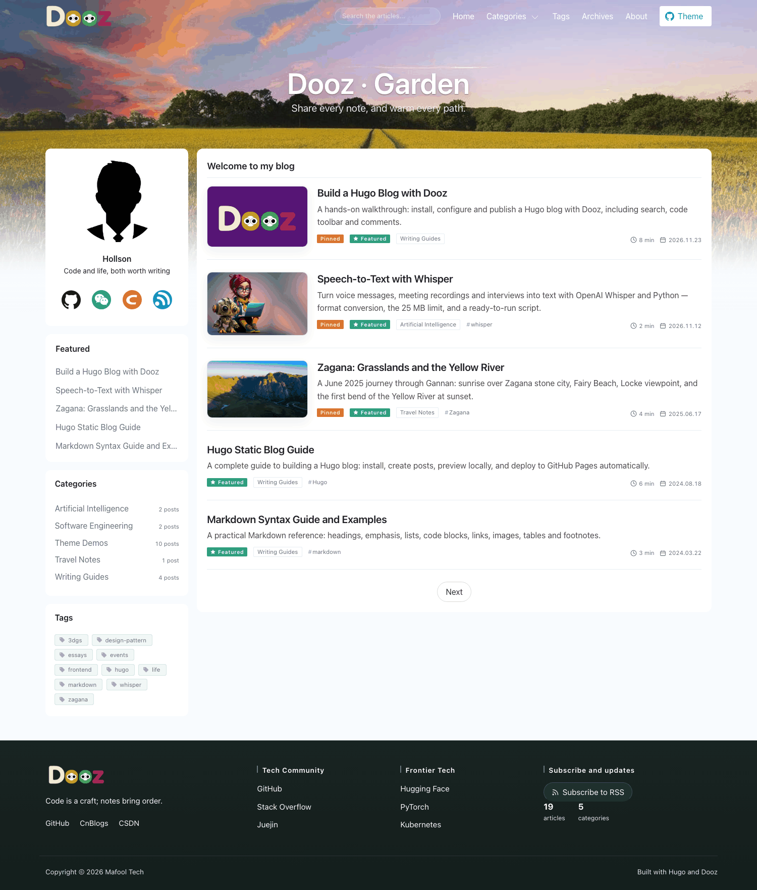
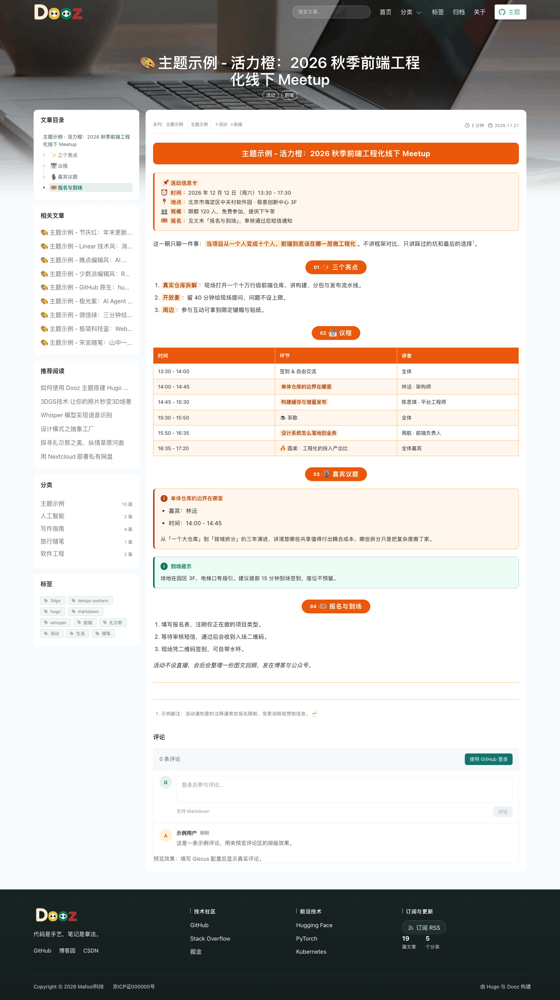

<div align="center">
<br/>


<br/>
<b>一款注重阅读体验、可自由定制的 Hugo 博客主题</b>
<br/>
<a href="README.md">English</a> | <a href="README.zh.md">中文</a>
<br/><br/>
</div>


Dooz 是一款专注阅读与写作的 Hugo 博客主题：文章用 Markdown 写，十套排版样式可按篇切换，搜索、目录与评论开箱即用。

<br/>

<div align="left">


<br/>
<sub>左：首页列表　右：文章页（十套正文样式任选）</sub>
</div>


<br/>

## 快速上手

只需 Hugo 0.158 或更高版本。

**1. 安装 Hugo**：按[官方文档](https://gohugo.io/installation/)选择对应系统的安装方式。安装完成后执行 `hugo version`，能输出版本号即表示安装成功。

**2. 创建站点并引入主题**

```bash
hugo new site my-blog
cd my-blog
git init

# 引入 Dooz 主题
git submodule add https://github.com/hollson/hugo-theme-dooz themes/hugo-theme-dooz

# 使用已配置好的示例配置
cp themes/hugo-theme-dooz/exampleSite/config.toml .
```

**3. 本地预览**

```bash
hugo server -D
```

访问 `http://localhost:1313`，即可看到一个包含文章、分类、标签、搜索与侧栏的完整博客。

如需先查看效果，可直接运行示例站。示例站包含近二十篇文章，覆盖全部十套正文样式：

```bash
cd themes/hugo-theme-dooz/exampleSite
hugo server --themesDir ../..
```

<br/>

## 写作与排版

文章放在 `content/post/` 目录下。执行下面的命令会按主题模板生成一篇带注释的新文章，填写 front matter 后即可写作：

```bash
hugo new post/hello.md
```

```yaml
---
title: "我的第一篇文章"
date: 2026-01-01T10:00:00+08:00
description: "一句话概括文章内容，用于列表展示与搜索结果。"
tags: ["随笔"]
cover_image: "/post/cover.jpg"   # 列表缩略图，可省略
mdTheme: "essay-songyan"         # 本篇正文样式，可省略
pinned: false                    # 置顶
weight: 100                      # 数值越小越靠前
---
```

常用字段的作用：

| 字段 | 作用 |
| :--- | :--- |
| `title` / `date` | 标题与发布时间，列表按时间倒序排列 |
| `description` | 摘要，显示在列表与搜索结果中 |
| `tags` / `categories` | 标签与分类，自动生成归档页 |
| `cover_image` | 列表缩略图，不填则显示纯文字卡片 |
| `mdTheme` | 本篇使用的正文样式，优先于全站默认 |
| `pinned` / `weight` | 置顶与排序，`weight` 不写时按 100 处理 |

正文使用标准 Markdown：标题、列表、表格、图片、引用、任务清单、代码块均可直接书写。代码块自动识别语言、支持一键复制与长代码折叠；需要流程图或公式时，在 front matter 加 `libraries: ["mermaid"]` 或 `["katex"]` 按需加载。

<br/>

## 样式外观

**正文样式**可按文章切换，也可设置全站默认：

```yaml
mdTheme: "dev-linear"
```

```toml
# config.toml
[params]
  markdownTheme = "dev-linear"
```

十套样式按适用场景划分：

- 产品评论、行业长文：`editorial-sspai`、`editorial-latepost`
- 散文、随笔、书评：`essay-songyan`
- 技术文档、接口说明、教程：`dev-linear`、`dev-tech-blue`、`dev-wechat-green`
- 活动通知、工作坊招募：`meetup-vibrant`、`meetup-aurora`
- 节日公告、年末总结：`daily-festive-red`
- 说明文档、配置手册：`plain-github`

**主题色**共五套，改一个参数即可整站生效：

```toml
[params]
  themeName = "navy"   # default / amber / navy / purple / terracotta
```

**站点信息**：标题、作者、头像、标语、页脚与社交账号均在 `config.toml` 中，每项附有中文注释。搜索、目录、评论与远程公告默认已配置，评论填入自己的仓库信息后即可启用。

<br/>

## 发布上线

从本地写作到域名绑定与自动部署，完整步骤见示例站中的这篇文章：[**Hugo 静态博客搭建与发布指南 →**](exampleSite/content/post/hugo-static-blog-guide.md)

GitHub Pages、Vercel 与 Netlify 均可用于托管，免费额度通常可以满足个人博客的需求。

<br/>

## 问题反馈

使用中遇到问题或有改进建议，欢迎[提交 Issue](https://github.com/hollson/hugo-theme-dooz/issues)；如果这个主题对你有帮助，欢迎点一个 **Star**。

<br/>

## License

本项目采用 [MIT](LICENSE) 协议开源。
