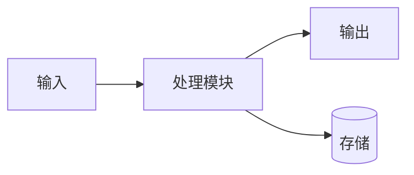

---
# ===== 基础信息（必填）=====
title: "{{ .Name }}"
slug: "{{ now.Unix }}"                 # URL 标识，生成 /post/<slug>
description: "一句话说清设计目标与核心结论"
keywords: ""                           # 搜索关键词，多个用逗号分隔
date: {{ now.Format "2006-01-02T15:04:05Z07:00" }}
draft: true                          # 📢 设为 false 才会发布
tags: []                             # 标签，如 ["架构", "设计"]
categories: []                       # 分类，如 ["技术设计"]

# ===== 可选字段（按需取消注释）=====
# hero_image: "/post/cover.jpg"
# libraries: ["mermaid"]             # 架构图 / 流程图
---


一篇好设计文档回答三件事：**为什么做、做什么、放弃了什么**。示例文字发布前替换掉即可。

<br/>

## 🎯 一. 背景

<!-- 要解决的问题、约束条件、现状 -->

当前面临 **XXX** 问题：现有方案在 `场景 A` 下出现了 `具体痛点`，影响到了 `业务或体验指标`。

- **现状**：一句话描述现在怎么做
- **痛点**：一句话说清哪里不够好
- **目标**：一句话给出期望结果

> 用一句话点明"为什么要做这件事"，让评审者立刻进入上下文。

<br/>

## 🏗️ 二. 方案

用一段话讲清整体思路，再分点展开：

1. **核心思路**：一句话概括方案本质
2. **模块划分**：说明各模块职责与交互关系
3. **关键流程**：用图胜过千言万语



<br/>

## ⚖️ 三. 关键取舍

没有银弹，写清楚每个选择的代价：

| 选项 | 优势 | 代价 | 结论 |
| --- | --- | --- | --- |
| 方案 A | 实现简单、易维护 | 扩展性一般 | ✅ 推荐 |
| 方案 B | 灵活可扩展 | 复杂度高、成本高 | 暂缓 |
| 方案 C | 性能最优 | 学习成本高 | 备选 |

> **结论**：综合当前规模与团队情况，选择 **方案 A**。

<br/>

## 🚀 四. 落地与验证

- **实施步骤**：1. 改造 A；2. 迁移 B；3. 灰度验证。
- **验证指标**：用数据或现象说明怎么判断方案成功（如响应时间下降 30%）。
- **回滚预案**：出问题时如何退回旧方案。

```bash
# 验证命令示例
hugo build --gc --minify && echo '构建通过'
```

---

*设计是权衡的艺术，记录选择，也记录放弃的理由。*
