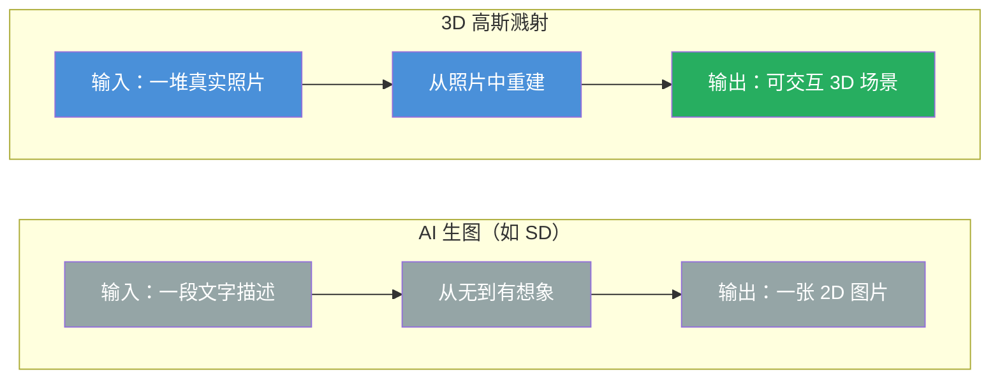

# 3DGS技术·让你的照片秒变3D场景

> 想象一下：你对着一栋建筑拍了几百张照片，几分钟后，电脑就把这栋建筑变成了一个可以随意旋转、走进去观看的3D场景。这就是3D高斯溅射（3D Gaussian Splatting，简称3DGS）正在做的事情。

读完这篇文章，你能搞懂四件事：它到底是什么、和 AI 画画有什么区别、怎么从照片一步步重建出场景、目前擅长什么又不擅长什么。

---

## 一、🧭 定位：它不是 AI 画画

很多人一听"高斯"就联想到 AI 生图。不是。

3D高斯溅射是一项**三维重建与渲染技术**，它解决的问题是：**如何把真实场景还原到电脑里，再快速、真实地画到你的屏幕上。**

它确实会用到机器学习来自动调参、让画面更逼真，但它的本质和 Stable Diffusion、Midjourney 完全不是一回事：后者是"看着文字凭空想象出一张图"，前者是"拿着真实照片还原出一个存在于空间里的场景"。

顺带解释一下名字：**高斯**指的是"高斯分布"——可以理解成一团中间浓、往四周逐渐变淡的雾气，和数学家高斯只是同名；**溅射（Splatting）**指把这些雾气一个个投影、摊到屏幕上拼成画面。

| | AI生图（如SD） | 3D高斯溅射 |
|---|---|---|
| 输入 | 一段文字描述 | 一堆真实照片 |
| 输出 | 一张2D图片 | 一个可交互的3D场景 |
| 核心能力 | 从无到有"想象" | 从照片中"重建" |

 

## 二、💡 那它到底是什么？

### 一个类比：折纸灯笼 vs 彩色烟雾

传统3D模型（网格 Mesh）像一个**折纸灯笼**：有明确的外壳、有棱有角的表面，由一片片三角面片拼出来。

3D高斯溅射不走这条路。它更像往空间里撒了**几百万个彩色烟雾泡泡**，不做外皮，直接靠这些泡泡密密麻麻堆叠出整个场景的观感。

每个"泡泡"就是一个3D高斯分布，用五个参数描述：

- **位置**：泡泡在3D空间中的坐标，决定它落在哪
- **胖瘦**：沿三个轴方向的大小，可以是扁的、长的、圆的
- **朝向**：旋转角度，决定泡泡歪向哪边
- **透明度**：有多实、有多透；通常中心浓、边缘淡
- **颜色**：而且这个颜色会随观看角度变化（靠球谐函数实现）——简单说，就是记录"从不同角度看过去颜色怎么变"，用来表现墙面、金属这类随视角反光的表面

还有一点值得注意：这些泡泡是**实实在在存在于文件里的**，每个都有具体参数，属于"显式表示"；不像后面要提到的 NeRF，把场景藏在一套神经网络权重里，看不见也摸不着。

### 渲染过程：泡泡叠出画面

当你从某个角度看这个场景时，电脑做的事情非常直觉：

1. 把每个泡泡**投影**到你的屏幕上，变成一个个椭圆形光斑
2. 按远近**排序**——远处先画，近处覆盖在上面（跟画画先铺背景、再画前景一个道理）
3. 每个光斑按透明度**叠加混合**，半透明的部分互相透色

最终屏幕上每一个像素的颜色，都是覆盖它的所有泡泡"投票"出来的。

补充一点：泡泡的数量不是固定的。训练过程中软件会自动增删——细节杂乱的地方（树叶、栏杆、纹理墙面）多撒泡泡，空旷平整的地方少留泡泡，既保质量又省开销。

 

## 三、🔥 为什么它突然火了？

在3DGS之前，最受关注的同类方案是 **NeRF**（神经辐射场）。它用一套神经网络来存场景，还原度很高，但**太慢了**：渲染一帧可能要几十秒，转个视角都要等半天，根本没法实时交互，更别说戴着 VR 头显走进去逛。

3DGS 的核心突破就是**快**，同时质量没有明显让步：

- **渲染速度**：每秒几十帧，旋转、缩放、走动都能实时跟上
- **重建质量**：真实场景的还原度非常高，细节和光影都比较自然
- **入门门槛**：有照片就能重建，不需要激光扫描仪之类的专业设备

2023 年 8 月这篇论文在 SIGGRAPH 发表并开源后，迅速引爆了学术界和工业界。工具链很快丰富起来，普通显卡也能跑小场景，短短一年里已经有人用它做 VR 场景、数字孪生、甚至电影特效。

需要说明的是，它目前对**静态场景**效果最好：照片覆盖的角度越全，重建出来的死角和空洞就越少。

 

## 四、🔧 重建流程有多简单？

整个流程可以概括为三步：

### 第一步：拍照

用手机或相机从不同角度拍摄同一个场景，几十张到几百张照片。

拍的时候有几个实用要点：

- **绕着场景走一圈**，前后左右、高处低处都覆盖到，别只站在一个方向拍
- **相邻照片要有重叠**，方便软件认出"这两张拍的是同一个墙角、同一扇窗"
- **尽量避开纯镜面、玻璃和强烈反光**，这类材质目前最容易出问题
- **场景保持静止**，拍摄过程中别有人走动、树叶乱晃，否则重建容易糊

### 第二步：自动优化

软件会先用传统方法（比如 **SfM**，运动恢复结构）得到一个粗略的初始场景。它干的事大白话讲就是：找出不同照片里的共同特征，反推出每张照片是从哪个位置、哪个角度拍的，先凑出一个稀疏的初始点云。

然后通过**可微渲染**不断调整每个泡泡的参数：

> "这个像素目前的颜色不对，离它最近的几个泡泡该怎么调，才能让渲染结果更接近真实照片？"

这个过程本质上是一个优化问题：先拿当前的泡泡渲一张图，跟真实照片对比，哪里有差距就反向推算每个泡泡该往哪调，用梯度下降反复迭代几百上千轮，越修越像。

### 第三步：得到3D场景

优化完成后，你就得到了一个由大量3D高斯组成的场景文件（格式通常是 `.ply` 或 `.splat`），里面存的就是每个泡泡的坐标、大小、朝向、透明度和颜色。用官方或社区提供的查看器打开，就能自由旋转、缩放、走动观看了。

硬件方面，这一步比较吃显卡：小场景在主流消费级独显上就能跑完，大场景、高精度重建需要更强的算力和更长的等待时间。

 

## 五、⚠️ 它有什么短板？

诚实地说，3DGS目前并不完美：

| 短板 | 说明 |
|---|---|
| **不好编辑** | 传统3D模型可以随意拖动顶点、摆位置、做动画，但3DGS的"泡泡"们没法直接编辑，想挪走一把椅子、改一面墙，往往要补拍或重新训练 |
| **占内存** | 几百万个泡泡，每个都要存参数，场景文件往往几十MB甚至几百MB，大场景对加载和显存都是压力 |
| **不适合做动画** | 角色动画、物体运动目前很难表现，远不如传统骨骼+蒙皮方案成熟 |
| **室内/反光场景挑战大** | 镜面反射、透明物体、复杂布料等材质还原还不够理想，容易出现模糊和漂移 |

简单说：**它非常擅长"把真实世界搬进电脑"，但还不擅长"在电脑里创作世界"。**

这些短板也是当前研究的热点：可编辑表示、文件压缩、动态场景重建都已有不少改进方案，但离成熟、通用的工程落地还有一段距离。

 

## 六、⚖️ 和它的前辈们比一比

| 技术 | 核心思路 | 速度 | 质量 | 编辑性 |
|---|---|---|---|---|
| **传统网格（Mesh）** | 三角面片拼表面 | ⚡ 很快 | 一般（看模型精度） | ✅ 很好 |
| **NeRF** | 神经网络隐式表达 | 🐌 很慢 | 🎯 很好 | ❌ 差 |
| **3DGS** | 显式高斯堆叠 | ⚡ 很快 | 🎯 很好 | ❌ 差 |

三者的定位可以这样理解：

- **Mesh**：最适合做可编辑的数字资产，游戏、动画里的角色和道具基本都是它，但精细建模或扫描成本高
- **NeRF**：把场景封进神经网络里，质量好，但慢、难改、难上手
- **3DGS**：用显式泡泡堆叠，在 NeRF 的质量和 Mesh 的速度之间找到了一个甜蜜点，代价是编辑性同样偏弱

它们之间更多是**按用途选型**，而不是谁彻底取代谁。

 

## 七、🎯 能用来做什么？

目前已经有实际应用的方向：

- **街景地图**：街道、园区、景区快速采集，生成可漫游的 3D 环境，Google Maps 已在部分城市试用类似技术
- **数字孪生**：工厂车间、楼宇建筑的 3D 数字化存档，便于复盘、展示和远程巡检
- **VR/AR**：快速搭出真实空间体验，比手工建模省大量人力
- **文化遗产**：古建筑、石窟、文物在受损或老化前做数字化留存，后续可用于展览和修复参考
- **影视特效**：真人实景的快速 3D 重建，辅助布景、镜头预览和后期合成

 

## 八、📝 一句话总结

> **3D高斯溅射 = 用几百万个"彩色烟雾泡泡"来表示3D场景，投影叠加成画面。拍照即可重建，渲染足够快，真实感拉满——但编辑和动画还是短板。**

它不是万能的，但在"快速重建真实场景"这件事上，目前没有比它更好的选择。如果想直观感受，最直接的办法是找一个开源 Demo，用自己手机拍一组照片跑一遍，效果比看十篇介绍都明白。

---

**参考资料：**

- Kerbl et al., "3D Gaussian Splatting for Real-Time Radiance Field Rendering", SIGGRAPH 2023
- https://repo-sam.inria.fr/fungraph/3d-gaussian-splatting/
- https://zhuanlan.zhihu.com/p/679809915

---

*如果你觉得这篇文章有帮助，欢迎点赞收藏转发。有问题也可以在评论区讨论~*
