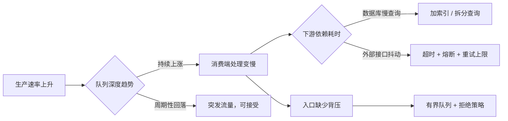

# 主题示例 - Linear 技术风：消息队列积压排查与背压设计

一份可以直接照着做的排查文档：先定位是哪一段在堆，再决定是扩容、限流，还是把拒绝提前到入口。以下指标与代码均为排版示例[^1]。

## 现象：P99 从 40ms 涨到 3s

监控上看不出错误率，只有延迟在慢慢抬升。这类问题通常不是「某处挂了」，而是「某处变慢，队列把慢放大了」。


## 排查路径



## 三个关键指标

| 指标 | 健康区间 | 说明 |
| :--- | :--- | :--- |
| 队列深度 | < 500 | 持续高于阈值说明消费能力不足 |
| 消费耗时 P99 | < 200ms | 单条消息的处理时间上限 |
| 拒绝率 | 0.1% ~ 1% | 完全为 0 通常意味着没有背压 |

## 背压实现

```ts
export class BoundedQueue<T> {
  private readonly items: T[] = [];

  constructor(
    private readonly capacity: number,
    private readonly handler: (item: T) => Promise<void>,
  ) {}

  async push(item: T): Promise<void> {
    if (this.items.length >= this.capacity) {
      throw new Error("BACKPRESSURE_REJECT");
    }
    this.items.push(item);
    await this.drain();
  }

  private async drain(): Promise<void> {
    while (this.items.length > 0) {
      const item = this.items.shift()!;
      await this.handler(item);
    }
  }
}
```

### 拒绝策略怎么选

- **快速失败**：入口直接返回 429，让调用方退避，适合可重试的任务。
- **降级写入**：先落盘再异步处理，适合不能丢的消息。
- **丢弃低优先级**：只在有明确优先级分层的系统里使用。

## 上线前的检查清单

- [x] 队列容量与拒绝阈值写进配置，不写死在代码里
- [x] 拒绝次数、队列深度接入监控面板
- [x] 下游超时时间小于上游超时时间
- [ ] 用两倍峰值流量做一次压测

> [!IMPORTANT] 结论
> 积压不是容量问题，而是「入口没有刹车」。先加背压，再谈扩容；顺序反了，扩容只会把雪崩推迟十分钟。

### 附：常用命令

```bash
# 查看队列深度与消费速率
redis-cli llen queue:events
redis-cli info stats | grep instantaneous_ops_per_sec
```

[^1]: 示例脚注：工程文档里的注释一般只补充版本、环境或已知限制。
