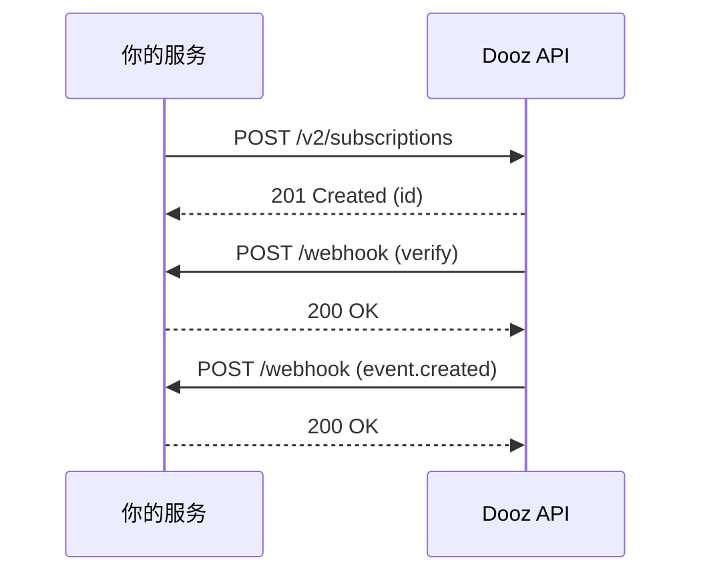

# 主题示例 - 极简科技蓝：Webhook 事件订阅 API v2 接入指南

本文演示一份接口文档在「极简科技蓝」下的密度与层次：端点用表格，时序用图，参数用列表，错误码单独成表。所有地址、字段与密钥均为示例[^1]。

## 概览

> [!NOTE] 版本说明
> v2 起事件投递改为「至少一次」，回调可能重复，请按 `event_id` 做幂等。旧版 v1 将在 2027-03-31 停止投递。


## 鉴权

所有请求使用 Bearer Token，令牌由控制台签发，可按环境隔离。

```http
POST /v2/subscriptions HTTP/1.1
Host: api.example.com
Authorization: Bearer sk_live_xxx
Content-Type: application/json
```

## 端点

| 方法 | 路径 | 用途 | 幂等 |
| :--- | :--- | :--- | :--- |
| POST | `/v2/subscriptions` | 创建订阅 | 否 |
| GET | `/v2/subscriptions/{id}` | 查询订阅 | 是 |
| DELETE | `/v2/subscriptions/{id}` | 删除订阅 | 是 |
| POST | `/v2/subscriptions/{id}/verify` | 重发验证 | 是 |

## 事件流



## 请求体

```json
{
  "url": "https://example.com/hooks/dooz",
  "events": ["article.created", "article.updated"],
  "secret": "whsec_example",
  "active": true
}
```

## 响应与错误码

| 状态码 | 含义 | 处理建议 |
| :--- | :--- | :--- |
| 201 | 创建成功 | 保存返回的 `id` |
| 400 | 参数校验失败 | 按 `errors[].field` 修正 |
| 401 | 令牌无效 | 检查环境与令牌前缀 |
| 409 | 回调地址重复 | 先删除旧订阅 |
| 429 | 触发限流 | 按 `Retry-After` 退避 |

> [!WARNING] 回调超时
> 接收端必须在 5 秒内返回 2xx，否则视为失败并重试。耗时逻辑请先入队，不要在回调里直接处理。

## 常见问题

事件重试次数
: 默认重试 5 次，间隔 1、5、15、60、180 分钟，可在控制台调整。

签名校验
: 使用 `secret` 对原始请求体计算 HMAC-SHA256，放在 `X-Dooz-Signature` 头里比对。

[^1]: 示例脚注：接口文档中的注释通常标注版本差异、限额或兼容性说明。
